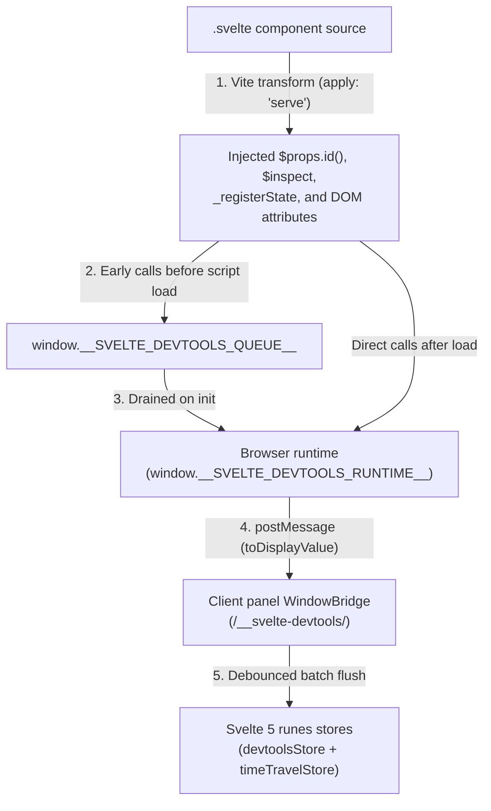
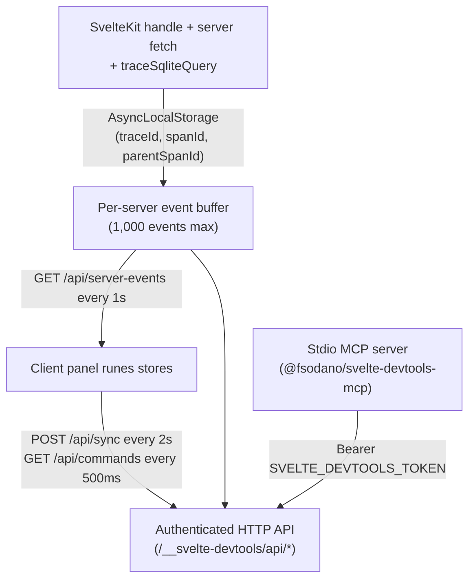
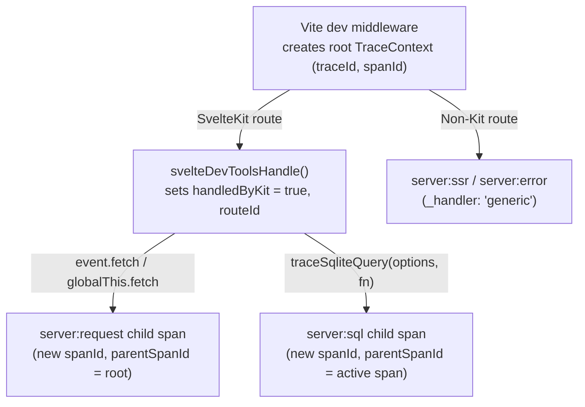

# Architecture overview

Svelte DevTools is a development-only debugging toolkit for **Svelte 5.20+ and SvelteKit on Vite 8**, built on `@vitejs/devtools-kit` (tested against host `@vitejs/devtools@0.4.8`). It provides mounted-instance component inspection, reactive state editing, snapshot time travel, browser `fetch` mocking, request-correlated SvelteKit and SQLite tracing, and local Model Context Protocol (MCP) tools for coding agents.

For user installation and feature walkthroughs, start with [README.md](../README.md). For contributor workflows, see [docs/INDEX.md](./INDEX.md).

## End-to-end architecture

Svelte 5 runes (`$state`, `$derived`, `$props`, `$effect`) are compile-time syntax transforms. They compile away before code runs in the browser, so no runtime global exists to hook them. Svelte DevTools solves this with a five-stage pipeline:

1. **Build-time instrumentation (`packages/vite-plugin`)**: During `vite dev`, the plugin transforms each `.svelte` file to assign a per-instance ID via `$props.id()`, tag owned DOM elements, register per-key state setters, wrap rune bindings in `$inspect(...).with(...)`, and instrument `$effect` callbacks.
2. **Browser runtime (`packages/runtime`)**: The plugin injects `/__svelte-devtools/svelte-runtime.js` into the page HTML. If a component initializes before the runtime script finishes loading, injected callbacks push functions onto `window.__SVELTE_DEVTOOLS_QUEUE__`. When `window.__SVELTE_DEVTOOLS_RUNTIME__` initializes, it drains the queue, tracks mounted instances, intercepts `window.fetch`, and emits sanitized events via `window.postMessage`.
3. **Client panel (`packages/client`)**: The Vite DevTools dock opens the prebuilt Svelte 5 panel from `/__svelte-devtools/` (served from `packages/client/dist/`). A `WindowBridge` receives `postMessage` events from the parent app window, feeds debounced Svelte 5 runes stores, and invokes live state setters on `window.parent.__SVELTE_DEVTOOLS__` (or `window.opener.__SVELTE_DEVTOOLS__`).
4. **Server tracing and HTTP API (`packages/vite-plugin`)**: The Vite dev server runs request-scoped `AsyncLocalStorage` tracing across SvelteKit requests, server `fetch` calls, and opt-in synchronous SQLite queries (`traceSqliteQuery`). The open client panel syncs its component, timeline, and snapshot state to `/__svelte-devtools/api/sync` every 2 seconds and polls `/__svelte-devtools/api/commands` every 500 ms for remote state edits.
5. **Agent MCP server (`packages/mcp`)**: `@fsodano/svelte-devtools-mcp` runs over stdio and translates nine typed MCP tools into token-authenticated HTTP requests against `/__svelte-devtools/api/*`.

### Build and runtime pipeline



### Server, HTTP sync, and agent pipeline



## Why `$inspect` injection?

In Svelte 5, runes such as `$state` and `$derived` are compiler instructions rather than runtime objects. Inspecting reactive state requires either compiler cooperation or source instrumentation before the Svelte compiler runs.

| Approach | Works with Svelte 5? | Trade-off |
|----------|---------------------|-----------|
| Runtime rune hooking | No | Runes compile away; no `window.svelte` or runtime store registry exists. |
| DOM scanning alone | No | DOM nodes do not expose internal `$state` or `$derived` bindings. |
| Build-time `$inspect` injection | Yes | Uses Svelte 5's public `$inspect(...).with(...)` API and lexical closures for setters. |

See [ADR-0006](./adr/ADR-0006-inspect-state-tracking.md) for the original decision and [ADR-0017](./adr/ADR-0017-instance-safe-state-mutation.md) for instance-safe identity and mutation.

## Package responsibilities

The repository is an npm workspace with five packages under `packages/`:

| Package | Published name | Role | Deep-dive guide |
|---------|----------------|------|-----------------|
| `packages/vite-plugin` | `@fsodano/vite-plugin-svelte-devtools` | `.svelte` AST transform, `svelte-devtools init` CLI, SvelteKit server hook, SQLite trace helper, editor launch, and authenticated HTTP API. | [02_vite-plugin.md](./02_vite-plugin.md), [05_server.md](./05_server.md) |
| `packages/runtime` | `@fsodano/svelte-devtools-runtime` | Browser runtime (`window.__SVELTE_DEVTOOLS_RUNTIME__`), queue drain, mounted-instance registry, element inspector overlay, and browser `fetch` interception. | [03_runtime.md](./03_runtime.md) |
| `packages/client` | `@fsodano/svelte-devtools-client` | Prebuilt Svelte 5 DevTools panel served from `packages/client/dist/`, `WindowBridge`, debounced runes stores, and 10 inspection tabs. | [04_client.md](./04_client.md) |
| `packages/types` | `@fsodano/svelte-devtools-types` | Shared TypeScript interfaces, event/RPC constants, `toDisplayValue` preview serializer, and `isJsonEditable` validator. | [06_api.md](./06_api.md) |
| `packages/mcp` | `@fsodano/svelte-devtools-mcp` | Stdio MCP server exposing nine typed inspection and state-mutation tools over the HTTP API. | [07_mcp.md](./07_mcp.md) |

## Stage 1: Build-time instrumentation (`packages/vite-plugin`)

`svelteDevTools()` registers a Vite plugin with `name: 'svelte-devtools'`, `apply: 'serve'`, and `enforce: 'pre'`. Because `apply` is `'serve'`, the transform and middleware never run during `vite build`.

When Vite loads a `.svelte` file outside `node_modules` and `.svelte-kit/generated`, the plugin parses the file with `svelte/compiler` (`parse(code, { filename, modern: true })`) and `@babel/parser`, then applies three transformations with `MagicString`:

1. **Per-instance identity and parent context (`injectComponentMetadata`)**:
   - Computes a file hash prefix `svt-<hash>` from the project-relative file path.
   - Injects `const __svt_<id>_uid = $props.id(); const __svt_<id> = "svt-<hash>:" + __svt_<id>_uid;` at the top of the instance `<script>` (or prepends a `<script>` block if the component has none). If the component already calls `$props.id()`, the transform reuses that declaration because Svelte allows only one `$props.id()` call per component.
   - Reads the parent component's instance ID via `getContext(Symbol.for('svelte-devtools.component-parent'))` and publishes its own ID via `setContext` so parent-child ancestry survives fragments, SvelteKit layouts, and slots.
   - Records instance metadata (`{ id, parentId, name, filename, propKeys }`) in `window.__SVELTE_DEVTOOLS_REGISTRY__` and calls `registerComponent` on `window.__SVELTE_DEVTOOLS_RUNTIME__` (or pushes the registration callback onto `window.__SVELTE_DEVTOOLS_QUEUE__`).
   - Registers an `onDestroy` hook that calls `unregisterComponent` and deletes the registry entry when the instance unmounts.
   - Tags every owned `RegularElement` and `SvelteElement` in the template AST (excluding `<title>`, `<meta>`, `<link>`, `<base>`, `<script>`, and `<style>`) with `data-svelte-devtools-id={__svt_<id>}` and `data-svelte-component="<ComponentName>"`.

2. **State, derived, props, and motion tracking (`injectStateInspection`)**:
   - Traverses variable declarations for `$state`, `$derived`, `$props`, `$bindable`, `untrack`, `$host`, and `Spring` / `Tween` class instances.
   - Resolves binding identifiers through object destructuring, array destructuring, aliases, default values, and rest patterns. Keys destructured from `$props()` are recorded in `propKeys`.
   - For writable `$state` and `$props` bindings (excluding `$derived` and `$derived.by`), registers a live setter via `runtime._registerState(instanceId, key, setter)`. For `let` bindings, the setter assigns `key = v`. For `const` object or array `$state` bindings, the setter mutates the array (`splice`) or object (`delete` + `Object.assign`) in place.
   - Appends an `$inspect(key).with((t, ...v) => ...)` call that invokes `runtime.handleState(instanceId, key, t, v[0])` whenever Svelte initializes or updates the value.
   - For `Spring` and `Tween` instances, registers a setter that updates `.set(val, { hard: true })` (or `.target` and `.current`) and injects an `$effect` that reports `{ current, target, stiffness, damping }` to `handleState`.

3. **Effect tracking (`injectEffectTracking`)**:
   - Traverses standalone `$effect(...)` and `$effect.pre(...)` expression statements and prepends `runtime.handleEffect(instanceId, effectKey, runeName, filename)` inside the callback body.
   - Counts rune usage and runs `analyzeMigration(code, id, runeCounts)` to score Svelte 4 patterns (`export let`, `$:`, `on:click`, `createEventDispatcher`, `writable`/`$store`, `<slot>`, `onMount`/`onDestroy`, `beforeUpdate`/`afterUpdate`) against Svelte 5 replacements.

See [02_vite-plugin.md](./02_vite-plugin.md) for transform details and [VITE.md](./VITE.md) for Vite 8 and Rolldown compatibility notes.

## Stage 2: Runtime loading and `window.__SVELTE_DEVTOOLS_QUEUE__` (`packages/runtime`)

In plain Vite applications (`transformIndexHtml`) and SvelteKit SSR responses (`transformPageChunk` in `svelteDevToolsHandle`), the plugin injects `<script type="module" src="/__svelte-devtools/svelte-runtime.js"></script>`. In SvelteKit applications, it also injects `<script type="module" src="/@svelte-devtools-navigation-bridge"></script>`, a virtual module that exposes SvelteKit's real `goto` function on `window.__SVELTE_DEVTOOLS_REAL_GOTO__` for cross-route time travel without stubbing application navigation ([ADR-0012](./adr/ADR-0012-stop-stubbing-app-navigation.md)).

### Early call buffering

Component module scripts can execute before `/__svelte-devtools/svelte-runtime.js` finishes loading. No inline passive runtime placeholder is used (removed in v0.4.0). Instead, every injected registration, `_registerState`, and `$inspect` snippet checks whether `window.__SVELTE_DEVTOOLS_RUNTIME__` exists:

```js
// Illustrative shape of the code injected by packages/vite-plugin/src/index.ts
if (window.__SVELTE_DEVTOOLS_RUNTIME__) {
  register(window.__SVELTE_DEVTOOLS_RUNTIME__);
} else {
  (window.__SVELTE_DEVTOOLS_QUEUE__ ||= []).push(register);
}
```

When `packages/runtime/src/index.ts` executes in the browser:

1. It binds all runtime methods onto `window.__SVELTE_DEVTOOLS_RUNTIME__`.
2. It iterates through `window.__SVELTE_DEVTOOLS_QUEUE__`, invokes each queued callback with `window.__SVELTE_DEVTOOLS_RUNTIME__`, and resets the queue to `[]`.
3. It exposes the public inspection and mutation surface on `window.__SVELTE_DEVTOOLS__` (`getComponentTree`, `getAllComponents`, `getComponentById`, `getWritableStateKeys`, `editComponentState`, `setComponentState`, `getTimeline`, `startInspectBatch`, `endInspectBatch`, `flushAllEffects`, `refresh`, `enableInspector`, `disableInspector`, `subscribe`, `trace`).
4. It calls `runtime.init()`, which emits `runtime-ready`, installs the browser `window.fetch` interceptor (`installNetworkTools`), and starts a `MutationObserver` on `document.body` to correlate `data-svelte-devtools-id` DOM elements with registered component instances.

### Safe display serialization vs. live values

Values crossing `postMessage` or HTTP boundaries pass through `toDisplayValue()` (`packages/types/src/display-value.ts`):

- Functions become `'[Function]'`, DOM nodes become `'[DOM Node]'`, Symbols become `'[Symbol]'`, BigInts become `'123n'`, circular references become `'[Circular]'`, and non-enumerable or getter properties are safely represented (`'[Getter]'`) without invoking application getters or `toString()` hooks.
- `Map` instances serialize as `{ type: 'Map', entries: [...] }` and `Set` instances serialize as `{ type: 'Set', values: [...] }`.
- Plain objects use a null-prototype container (`Object.create(null)`) so inherited `Object.prototype` properties cannot collide with application keys.

Because `toDisplayValue()` produces a lossy preview, **serialized previews are never written back into live state** ([ADR-0020](./adr/ADR-0020-bounded-observation-and-live-value-separation.md)). Before allowing an edit or snapshot restore on a key, the runtime checks the live value in `state.components.get(id).state.get(key)` with `isJsonEditable()` (`packages/types/src/json-state.ts`). Only JSON-safe primitives, plain objects, and dense arrays with registered setters are writable.

See [03_runtime.md](./03_runtime.md) for the complete runtime event and setter contract.

## Stage 3: Client panel, bridge, and runes stores (`packages/client`)

The Vite plugin registers a dock entry (`DOCK_CONFIG` in `packages/types/src/constants.ts`) with `type: 'iframe'` and `url: '/__svelte-devtools/'`. In supported Chromium browsers, `@vitejs/devtools` renders this dock entry in a `DocumentPictureInPicture` popup window; in headless Chromium, it renders as an embedded iframe.

When the dev server serves `/__svelte-devtools/index.html`, it injects `window.__SVELTE_DEVTOOLS_TOKEN__` into `<head>` and sets `Content-Security-Policy: frame-ancestors 'self'` and `X-Frame-Options: SAMEORIGIN` so external sites cannot frame the token-bearing panel.

### WindowBridge and debounced state batching

1. **`WindowBridge` (`packages/client/src/lib/bridge/window-bridge.ts`)**:
   - Listens for `message` events from `window.parent` (when embedded) or `window` and verifies that `event.source` matches the target window and `event.origin` is an allowed local origin (`localhost`, `127.0.0.1`, `::1`, `[::1]`).
   - Maps runtime event types (`component-register`, `component:unmount`, `state`, `effect`, `client:request`, `inspect:toggle`, `inspect:select`) to bridge events.
   - Polls `window.parent.__SVELTE_DEVTOOLS__.getAllComponents()` every 500 ms as a reconciliation fallback for components mounted before the panel opened.

2. **Debounced state batching and motion gate (`packages/client/src/lib/stores/devtools-store.svelte.ts`)**:
   - `$inspect` fires synchronously on every reactive assignment. To prevent cascading UI re-renders during bursts (such as 20 `PokemonCard` components loading data or a `Spring` animating at 60 fps), `handleStateChange` queues incoming events in `pendingStateChanges` ([ADR-0002](./adr/ADR-0002-debounced-state-change-batching.md)).
   - **Motion gate**: When a `Spring` or `Tween` emits `{ current, target }`, mid-animation frames where `Math.abs(current - target) >= 0.0015` are added to `activeMotions` and dropped from the batch. While `activeMotions.size > 0`, snapshot recording waits. Once the motion settles (or if the animating component unmounts), the gate releases and records the settled value.
   - On the next macrotask (`setTimeout(..., 0)`), `flushStateChanges()` collapses queued updates to the latest value per `(componentId, key)`, updates the `components` array in one pass, and appends a batch of `state:change` entries to `timeline` (capped at 1,000 entries).

3. **Time travel and instance resolution (`packages/client/src/lib/stores/time-travel-store.svelte.ts`)**:
   - Time travel starts paused (`isRecording = false`), except when the user or an agent saves a state edit, which automatically enables recording and captures a `'Before state edit'` baseline snapshot.
   - Restoring a snapshot resolves target component IDs via `resolveSnapshotInstances()` (`packages/client/src/lib/stores/snapshot-identity.ts`). It matches exact live instance IDs first. If a cross-route navigation remounted the component with a new ID, it remaps by `filename` only when both the snapshot and the live tree contain exactly one instance of that file. If multiple instances share the filename, restore rejects with an explicit error instead of mutating an arbitrary sibling ([ADR-0017](./adr/ADR-0017-instance-safe-state-mutation.md)).

See [04_client.md](./04_client.md) for the 10 panel tabs and [design-guidelines.md](./design-guidelines.md) for layout, theme, and error-boundary rules.

## Stage 4: Server tracing and the authenticated HTTP API (`packages/vite-plugin`)

### Request-scoped server and SQLite tracing

Server tracing correlates outer HTTP requests, SvelteKit server execution, nested `fetch` calls, and synchronous SQLite queries using Node's `AsyncLocalStorage` ([ADR-0018](./adr/ADR-0018-request-scoped-server-traces.md)):



- **Shared `AsyncLocalStorage` context (`packages/vite-plugin/src/trace-context.ts`)**: Stored under `Symbol.for('svelte-devtools.trace-context.v1')` on `globalThis` so the Vite plugin environment and the Vite SSR module loader share the same active `TraceContext` (`traceId`, `spanId`, `routeId`, `emit`).
- **Non-blocking body previews (`packages/vite-plugin/src/sveltekit.ts`)**: `capturePreview()` clones the request or response stream and reads up to 2,000 bytes (JSON) or 500 bytes (other content types) with a 250 ms timeout on the inspection branch, then cancels the cloned reader so streaming SSR and Server-Sent Events (SSE) never stall waiting for DevTools.
- **Explicit synchronous SQLite spans (`packages/vite-plugin/src/sqlite.ts`)**: Applications wrap synchronous driver calls (such as `better-sqlite3`) in `traceSqliteQuery({ enabled: dev, database, operation, statement, captureStatement }, () => ...)`. It measures execution with `performance.now()` and emits a `server:sql` child span with `traceId`, `spanId`, `parentSpanId`, `rowCount`, and (when `captureStatement: true`) up to 4,096 characters of the SQL template. Parameter bindings and result rows are never captured ([ADR-0019](./adr/ADR-0019-explicit-synchronous-sqlite-observation.md)).
- **Retention**: Each `ViteDevServer` instance owns an isolated event buffer capped at 1,000 events (`packages/vite-plugin/src/server-events.ts`). The Network panel combines client and server entries in a `NetworkHistory` buffer capped at 500 rows (`packages/client/src/lib/network-history.ts`).

See [05_server.md](./05_server.md) for server hook composition and SQLite setup.

### Token-authenticated HTTP API and command broker

All endpoints under `/__svelte-devtools/api/*` (plus legacy `/__svelte-devtools/server-events`, `/__svelte-devtools/migration-score`, and `/__svelte-devtools/open-in-editor`) enforce two security guards ([ADR-0009](./adr/ADR-0009-secure-agent-http-api.md)):

1. **Host allow-list**: `isAllowedHost` rejects requests whose `Host` header is not `localhost`, `127.0.0.1`, `::1`, `[::1]`, or an entry in `allowedHosts` / `SVELTE_DEVTOOLS_ALLOWED_HOSTS` with `403 Forbidden host` (DNS-rebinding defense).
2. **Per-run bearer token**: `isAuthorized` checks `Authorization: Bearer <token>` (or `?token=<token>`) against `SVELTE_DEVTOOLS_TOKEN` (generated with `randomBytes(32)` at server startup if not set in the environment). Missing or invalid tokens receive `401 Unauthorized`. CORS reflects only allow-listed origins with `Vary: Origin`.

Note: **Two separate credentials exist during development.** The Vite DevTools dock UI uses a six-digit `devframe auth code` printed by `@vitejs/devtools`. The HTTP API and MCP server use `SVELTE_DEVTOOLS_TOKEN`.

Because component instances exist inside the browser tab, the Vite server does not hold a direct reference to browser memory:

- **Panel sync (`POST /__svelte-devtools/api/sync`)**: Each open panel generates a `panelSessionId` (`crypto.randomUUID()`) and posts `{ sessionId, components, timeline, snapshots, branches }` to `/api/sync` every 2 seconds with at most one request in flight and a 10-second timeout. The server caches up to 64 panel sessions.
- **Acknowledged remote state edits (`POST /__svelte-devtools/api/set-state`)**: The server never mutates its cache directly ([ADR-0010](./adr/ADR-0010-agent-http-api-live-truth.md)). Instead, `CommandBroker` (`packages/vite-plugin/src/command-broker.ts`) queues a command for the target `sessionId`. The open panel polls `GET /__svelte-devtools/api/commands?sessionId=<id>&url=<url>` every 500 ms, executes the edit through `timeTravel.setStateEdit(componentId, key, value)`, reads back the live state value, and posts the acknowledgement to `POST /__svelte-devtools/api/commands/result`. If the panel does not acknowledge within 5 seconds, the broker returns `OUTCOME_UNKNOWN` (if delivered) or `COMMAND_NOT_DELIVERED` without retrying.

See [06_api.md](./06_api.md) for the complete HTTP endpoint and payload reference.

## Stage 5: Stdio MCP adapter (`packages/mcp`)

`@fsodano/svelte-devtools-mcp` wraps the authenticated HTTP API in a local stdio Model Context Protocol server ([ADR-0016](./adr/ADR-0016-mcp-adapter-over-authenticated-http.md)):

- Exposes nine tools: `svelte_status`, `svelte_components`, `svelte_timeline`, `svelte_snapshots`, `svelte_routes`, `svelte_migration`, `svelte_server_events`, `svelte_source`, and `svelte_set_state`.
- Validates that `SVELTE_DEVTOOLS_URL` is a clean HTTP(S) origin and sends `Authorization: Bearer <SVELTE_DEVTOOLS_TOKEN>` on every request.
- Enforces freshness checks on runtime cache reads (`maxAgeMs`, default 10,000 ms), returning `NO_RUNTIME_DATA` if the panel has never synced or `STALE_RUNTIME_DATA` if the cache is older than `maxAgeMs`.
- Bounds HTTP responses to 4 MiB (`MAX_HTTP_RESPONSE_BYTES`) and serialized tool outputs to 512 KiB (`MAX_TOOL_OUTPUT_BYTES`), and redacts `SVELTE_DEVTOOLS_TOKEN` from any error message.

See [07_mcp.md](./07_mcp.md) for MCP tool schemas, pagination, and agent workflows.

## Current coverage and scope boundaries

Cold readers and tool authors should keep these boundaries in mind:

- **Transformed `.svelte` files only**: Build-time instrumentation applies only to `.svelte` component files processed by the Vite plugin (`include` defaults to `[/\.svelte$/]`, `exclude` defaults to `[/node_modules/]` plus `.svelte-kit/generated`). Standalone `.svelte.ts` / `.svelte.js` rune modules and precompiled third-party component libraries are not instrumented.
- **Migration scoring covers transformed files**: `/__svelte-devtools/api/migration` and the Migrate tab report scores only for `.svelte` files that Vite has compiled in the current dev server run (`overall` is `null` until at least one file is transformed). It is not a full-repository static audit.
- **Open, authorized panel required for runtime data**: Component trees, state values, timeline events, snapshots, and `svelte_set_state` mutations depend on an open, authorized Svelte DevTools panel syncing to the dev server. Server traces (`server-events`), route scans (`routes`), migration scores (`migration`), and source lookups (`source`) work directly from the dev server without an open panel.
- **Browser `fetch` mocking only**: Mock rules created in the Network panel intercept browser `window.fetch` calls via `NetworkInterceptor` (`fetchOnly: true`). They do not intercept `XMLHttpRequest`, Service Worker fetches, or server-side `fetch` calls during SvelteKit SSR.
- **State time travel does not roll back external side effects**: Restoring a snapshot writes cached JSON-editable values back into mounted component setters (and navigates via `goto` when the route URL changed). It does not undo database writes, remote API mutations, timers, or uninstrumented external stores.
- **Opt-in, synchronous SQLite observation**: `traceSqliteQuery` measures synchronous callbacks inside an active request `TraceContext`. Statement templates are omitted unless `captureStatement: true` is passed, and bound parameter values and result rows are never collected.
- **Filesystem route inventory**: `/__svelte-devtools/api/routes` scans the resolved SvelteKit routes directory (`src/routes` by default). It preserves route groups and bracket parameter metadata, and marks dynamic routes (`[slug]`) as non-navigable templates because they require concrete parameter values.
- **Browser coverage**: Chromium is the tested browser for both embedded iframe and `DocumentPictureInPicture` dock modes. Cross-browser parity in Firefox or Safari is not claimed.

See the [completion audit](./validation/devtools-completion-audit.md) and [SSR/SQLite validation report](./validation/ssr-sql-observability-validation.md) for verification evidence.
