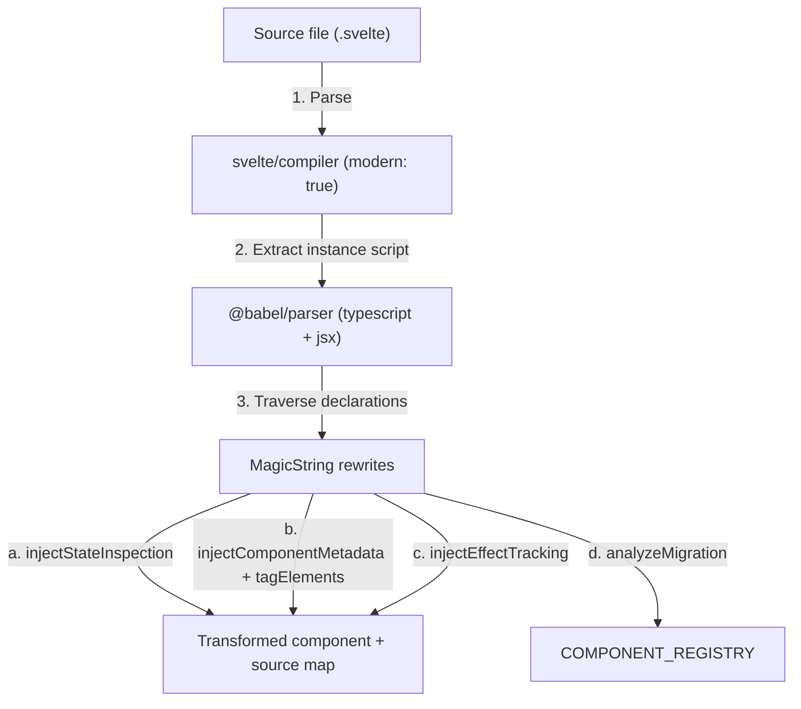

# Vite plugin

The Vite plugin (`packages/vite-plugin`) is the build-time entry point for Svelte DevTools. It transforms `.svelte` component source files to inject instance metadata, `$inspect` state hooks, and `$effect` trackers. During development, it also registers the DevTools dock with `@vitejs/devtools-kit`, serves the pre-built runtime and panel UI, and exposes the token-authenticated HTTP API.

> **Implementation note**: `svelteDevTools()` (`packages/vite-plugin/src/index.ts`) returns one Vite plugin configured with `apply: 'serve'` and `enforce: 'pre'`. Supporting modules in `packages/vite-plugin/src/` implement the HTTP API (`server-api.ts`), Host and Origin guards (`http-guard.ts`), per-run token auth (`token.ts`), command broker (`command-broker.ts`), editor integration (`editor.ts`), SvelteKit route scanner (`route-scanner.ts`), migration analyzer (`migration-analyzer.ts`), and correlated server and SQLite tracing (`sveltekit.ts`, `sqlite.ts`, `trace-context.ts`, `server-events.ts`).

## Installation

Install the plugin and the tested Vite DevTools host in your Svelte application:

```bash
npm install -D @fsodano/vite-plugin-svelte-devtools@0.4.0 @vitejs/devtools@0.4.8
npx svelte-devtools init
npm run dev
```

Run these commands in the application directory containing `package.json`. The `npx svelte-devtools init` command (`packages/vite-plugin/bin/setup.mjs`) parses your Vite configuration with `@babel/parser` without executing user code:

- It verifies that `@fsodano/vite-plugin-svelte-devtools` and `@vitejs/devtools` are listed in `package.json`, and checks for a single standard `vite.config.ts`, `.js`, `.mts`, or `.mjs` file.
- It prepends `DevTools()` to the `plugins` array and inserts `svelteDevTools()` right after `svelte()` or `sveltekit()`, using collision-safe import aliases if those identifiers already exist in the file.
- For SvelteKit apps, it creates `src/hooks.server.ts` (or `.js` matching the Vite config extension) with the development-only `svelteDevToolsHandle()` wrapper.
- It preserves existing adapter and compiler options. You do not need to build the DevTools packages when installing from npm.

Use `npx svelte-devtools init --dry-run` to preview the file edits without writing to disk. Repeating the command does not duplicate existing edits. If your Vite config uses spreads, methods, computed properties, or dynamic expressions—or if `src/hooks.server.*` already contains custom logic or custom `files` paths—the command makes no partial edits and points to the manual setup below.

### Source development

Use this workflow only when contributing to the Svelte DevTools repository. The npm package above already bundles the built client and runtime.

```bash
git clone https://github.com/fsodano/svelte-devtools.git
cd svelte-devtools
npm ci
npm run build

# Run one of the sample apps (each uses --strictPort):
# tests/apps/svelte (5173), svelte-kit (5174), todo-sqlite (5175), pokedex (5176)
npm ci --prefix tests/apps/svelte
npm run dev --prefix tests/apps/svelte -- --port 5173 --strictPort
```

To test a local checkout against an external project, build the workspace and install `packages/vite-plugin` as a local dependency:

```bash
# Run in your application; replace the absolute path with your checkout.
npm install --save-dev /absolute/path/to/svelte-devtools/packages/vite-plugin @vitejs/devtools@0.4.8
```

When you edit `packages/client` or `packages/runtime` in the checkout, run `npm run build` and restart the application dev server so it serves the updated artifacts from `dist/`.

The package declares `engines.node` as `^20.19.0 || >=22.12.0`, alongside peer dependencies `vite@^8.0.3` and `svelte@^5.20.0` (with optional `@sveltejs/kit@^2.55.0`). CI tests Node.js 22 and 24, and Node.js 24 is the documented workflow. The engines range also accepts Node.js 20.19+, which CI does not test. The repository fixtures run on Vite 8.2.2 (Rolldown-powered) with `@vitejs/devtools` 0.4.8 in Chromium.

## Manual usage

### Plain Vite

```typescript
// vite.config.ts
import { defineConfig } from 'vite';
import { DevTools } from '@vitejs/devtools';
import { svelte } from '@sveltejs/vite-plugin-svelte';
import { svelteDevTools } from '@fsodano/vite-plugin-svelte-devtools';

export default defineConfig({
  plugins: [
    DevTools(),
    svelte(),
    svelteDevTools()
  ]
});
```

### SvelteKit

Keep any existing options inside `sveltekit(...)`. If you did not run `npx svelte-devtools init`, add the plugins to `vite.config.ts` and wire the server hook in `src/hooks.server.ts`:

```typescript
// vite.config.ts
import { defineConfig } from 'vite';
import { sveltekit } from '@sveltejs/kit/vite';
import { DevTools } from '@vitejs/devtools';
import { svelteDevTools } from '@fsodano/vite-plugin-svelte-devtools';

export default defineConfig({
  plugins: [DevTools(), sveltekit(), svelteDevTools()]
});
```

```typescript
// src/hooks.server.ts
import { dev } from '$app/environment';
import type { Handle } from '@sveltejs/kit';
import { svelteDevToolsHandle, noopHandle } from '@fsodano/vite-plugin-svelte-devtools/sveltekit';

export const handle: Handle = dev ? svelteDevToolsHandle() : noopHandle();
```

If your application already defines a `handle` hook in `src/hooks.server.ts`, compose it with SvelteKit's `sequence()` helper:

```typescript
// src/hooks.server.ts
import { dev } from '$app/environment';
import { sequence } from '@sveltejs/kit/hooks';
import { svelteDevToolsHandle, noopHandle } from '@fsodano/vite-plugin-svelte-devtools/sveltekit';

export const handle = sequence(
  dev ? svelteDevToolsHandle() : noopHandle(),
  yourExistingHandle
);
```

**Plugin order**: Place `DevTools()` (the Vite DevTools host) first, then `svelte()` or `sveltekit()`, then `svelteDevTools()`. Because `svelteDevTools()` sets `enforce: 'pre'`, its `transform` hook runs on raw `.svelte` source before the Svelte compiler compiles the component into JavaScript.

### Configuration options

`SvelteDevToolsPluginOptions` is defined in `packages/types/src/index.ts`:

```typescript
// Source: packages/types/src/index.ts (SvelteDevToolsPluginOptions)
export interface SvelteDevToolsPluginOptions {
  /** Enable state inspection via $inspect injection (default: true) */
  enableStateInspection?: boolean;
  /** File patterns to include (default: [/\.svelte$/]) */
  include?: RegExp[];
  /** File patterns to exclude (default: [/node_modules/]) */
  exclude?: RegExp[];
  /**
   * Extra CORS origins allowed to call the agent HTTP API (ADR-0009).
   * Localhost/127.0.0.1/[::1] origins are always allowed; add any others.
   */
  allowedOrigins?: string[];
  /**
   * Extra Host header values allowed to call the agent HTTP API (ADR-0009).
   * Localhost/127.0.0.1/[::1] hosts are always allowed; add any others.
   */
  allowedHosts?: string[];
}
```

- `include` and `exclude`: Passed to Vite's `createFilter(include, exclude)`. In addition to `exclude` (which defaults to `[/node_modules/]`), the `transform` hook always skips files matching `/\.svelte-kit\/generated/`.
- `enableStateInspection`: When `false`, the plugin skips `$inspect` and `_registerState` setter injection (`injectStateInspection`), while still injecting component metadata, DOM attributes, and effect tracking.
- `allowedOrigins` and `allowedHosts`: Extend the HTTP guard (`packages/vite-plugin/src/http-guard.ts`) for non-local development hosts. You can also supply comma-separated lists via the `SVELTE_DEVTOOLS_ALLOWED_ORIGINS` and `SVELTE_DEVTOOLS_ALLOWED_HOSTS` environment variables. See [ADR-0009](adr/ADR-0009-secure-agent-http-api.md).

**Scope limits**: Instrumentation applies only to `.svelte` component files that pass through the Vite `transform` hook. Standalone `.svelte.ts` and `.svelte.js` rune modules and precompiled third-party component libraries in `node_modules` are not instrumented.

## How the build-time transform works

### Transform pipeline

For each matching `.svelte` file, the `transform` hook (`packages/vite-plugin/src/index.ts`) parses the component with `svelte/compiler` (`parse(code, { filename, modern: true })`), extracts the instance `<script>` block (module `<script module>` blocks cannot reference per-instance IDs and are ignored), parses the script with `@babel/parser` (`typescript` and `jsx` plugins), and rewrites the source with `MagicString`:



If any injection step throws, the plugin logs a transform error through `ctx.logs.add` and returns `null` so Vite compiles the original `.svelte` file unmodified.

### 1. Stable file ID and per-instance ID

First, `getStableId(id, root)` computes a deterministic file-level base ID (`svt-<hash36>`) from the file path relative to the Vite project root:

```typescript
// Source: packages/vite-plugin/src/index.ts (getStableId)
function getStableId(id: string, root: string): string {
    const relPath = path.relative(root, id);
    let hash = 0;
    for (let i = 0; i < relPath.length; i++) {
        hash = ((hash << 5) - hash) + relPath.charCodeAt(i);
        hash |= 0;
    }
    return `svt-${Math.abs(hash).toString(36)}`;
}
```

A file-level ID alone cannot distinguish multiple mounted instances of the same component (such as items in an `{#each}` block). Inside `injectComponentMetadata`, the transform creates a unique runtime instance ID stored in a local constant named `__svt_<normalized_componentId>` (generated by `instanceRef(componentId)`):

```javascript
// Illustrative sketch of code injected by injectComponentMetadata (packages/vite-plugin/src/index.ts)
const __svt_svt_abc123_uid = $props.id();
const __svt_svt_abc123 = "svt-abc123:" + __svt_svt_abc123_uid;
```

- `$props.id()` is Svelte 5.20+'s built-in per-instance unique ID rune.
- `__svt_svt_abc123` combines the file ID (`svt-abc123`) and the instance suffix (`:uid`) so every mounted instance has its own key in the registry and setter store.
- Because Svelte allows only one `$props.id()` call per component, `injectComponentMetadata` scans top-level variable declarations first. If the component already declares `const myId = $props.id()`, the transform hoists `$props.id()` into `__svt_svt_abc123_uid` and rewrites `myId`'s initializer to `__svt_svt_abc123_uid`. See [ADR-0017](adr/ADR-0017-instance-safe-state-mutation.md).

### 2. Component metadata, parent context, and cleanup injection

At the start of the instance `<script>` (or in a prepended `<script>` block if the component has no script), `injectComponentMetadata` (`packages/vite-plugin/src/index.ts`) injects lifecycle and context wiring:

```javascript
// Illustrative sketch of code injected by injectComponentMetadata (packages/vite-plugin/src/index.ts)
import {
  onDestroy as __svt_svt_abc123_destroy,
  getContext as __svt_svt_abc123_getContext,
  setContext as __svt_svt_abc123_setContext
} from 'svelte';
const __svt_svt_abc123_uid = $props.id();
const __svt_svt_abc123 = "svt-abc123:" + __svt_svt_abc123_uid;
const __svt_svt_abc123_context = Symbol.for('svelte-devtools.component-parent');
const __svt_svt_abc123_parent = __svt_svt_abc123_getContext(__svt_svt_abc123_context);
__svt_svt_abc123_setContext(__svt_svt_abc123_context, __svt_svt_abc123);
let __svt_svt_abc123_alive = true;
if (typeof window !== 'undefined') {
  window.__SVELTE_DEVTOOLS_REGISTRY__ ||= new Map();
  window.__SVELTE_DEVTOOLS_REGISTRY__.set(__svt_svt_abc123, {
    id: __svt_svt_abc123,
    parentId: __svt_svt_abc123_parent,
    name: "Counter",
    filename: "/src/lib/Counter.svelte",
    propKeys: ["name"]
  });
  const register = (r) => {
    if (__svt_svt_abc123_alive) r.registerComponent(__svt_svt_abc123, "Counter", "/src/lib/Counter.svelte");
  };
  if (window.__SVELTE_DEVTOOLS_RUNTIME__) register(window.__SVELTE_DEVTOOLS_RUNTIME__);
  else (window.__SVELTE_DEVTOOLS_QUEUE__ ||= []).push(register);
}
__svt_svt_abc123_destroy(() => {
  __svt_svt_abc123_alive = false;
  if (typeof window !== 'undefined') {
    window.__SVELTE_DEVTOOLS_RUNTIME__?.unregisterComponent(__svt_svt_abc123);
    window.__SVELTE_DEVTOOLS_REGISTRY__?.delete(__svt_svt_abc123);
  }
});
```

- `Symbol.for('svelte-devtools.component-parent')`: Tracks parent-child hierarchy via Svelte's `getContext` and `setContext`. This preserves component hierarchy across fragments, snippets, and layout boundaries even when a component renders no root DOM element.
- `window.__SVELTE_DEVTOOLS_QUEUE__`: If the component mounts before `/__svelte-devtools/svelte-runtime.js` finishes loading, `register` is pushed onto `window.__SVELTE_DEVTOOLS_QUEUE__`. The `__svt_..._alive` flag prevents a queued callback from registering an instance that already unmounted before the queue drained.
- `onDestroy`: Calls `unregisterComponent` and removes the instance entry from `window.__SVELTE_DEVTOOLS_REGISTRY__`.

### 3. DOM data attribute injection

To correlate mounted component instances with DOM nodes for the element inspector and `DomInfo` view, `tagElements` (`packages/vite-plugin/src/index.ts`) walks `ast.fragment` from the Svelte compiler AST and adds attributes to every owned `RegularElement` and `SvelteElement`:

```svelte
<!-- Input component template -->
<div class="counter">
  <button>Click</button>
</div>

<!-- Output after tagElements (illustrative sketch) -->
<div data-svelte-devtools-id={__svt_svt_abc123} data-svelte-component="Counter" class="counter">
  <button data-svelte-devtools-id={__svt_svt_abc123} data-svelte-component="Counter">Click</button>
</div>
```

- Tagging every owned element in `ast.fragment` (rather than only the first regex match in the file) ensures that components with multiple root elements or conditional `{#if}` branches still carry `data-svelte-devtools-id` in the live DOM, without corrupting markup-like strings or child component props.
- Metadata and non-visual tags are skipped: `title`, `meta`, `link`, `base`, `script`, and `style`.

### 4. State inspection and setter injection

When `enableStateInspection` is `true`, `injectStateInspection` (`packages/vite-plugin/src/index.ts`) traverses variable declarations in the instance script via `findStateDeclarations` and `extractRuneDeclarations`, then appends code created by `createInjectCode` after each declaration. See [ADR-0006](adr/ADR-0006-inspect-state-tracking.md) and [ADR-0017](adr/ADR-0017-instance-safe-state-mutation.md).

```javascript
// Before transform
let count = $state(0);

// After transform (illustrative sketch from createInjectCode in packages/vite-plugin/src/index.ts)
let count = $state(0);
if (typeof window !== 'undefined') {
  const register = (r) => {
    if (window.__SVELTE_DEVTOOLS_REGISTRY__?.has(__svt_svt_abc123))
      r._registerState(__svt_svt_abc123, 'count', (v) => { count = v; });
  };
  if (window.__SVELTE_DEVTOOLS_RUNTIME__) register(window.__SVELTE_DEVTOOLS_RUNTIME__);
  else (window.__SVELTE_DEVTOOLS_QUEUE__ ||= []).push(register);
}
$inspect(count).with((t, ...v) => {
  if (typeof window !== 'undefined') {
    const inspect = (r) => {
      if (window.__SVELTE_DEVTOOLS_REGISTRY__?.has(__svt_svt_abc123))
        r.handleState(__svt_svt_abc123, 'count', t, v[0]);
    };
    if (window.__SVELTE_DEVTOOLS_RUNTIME__) inspect(window.__SVELTE_DEVTOOLS_RUNTIME__);
    else (window.__SVELTE_DEVTOOLS_QUEUE__ ||= []).push(inspect);
  }
});
```

- `_registerState`: Registers a closure `(v) => { count = v; }` keyed by the per-instance ID (`__svt_svt_abc123`) and variable name (`'count'`). Time travel and live state editing call this setter to mutate the live rune in place.
- `$inspect(count).with(...)`: Svelte 5's built-in reactive inspector rune. It fires with `t = 'init'` on initial evaluation and `t = 'update'` whenever `count` changes, passing the current value `v[0]` to `runtime.handleState`.
- Both callbacks check `window.__SVELTE_DEVTOOLS_REGISTRY__?.has(ref)` so late echoes after component destruction are ignored, and both fall back to `window.__SVELTE_DEVTOOLS_QUEUE__` if the runtime module has not loaded yet.

Supported declaration patterns (`extractRuneDeclarations` uses Babel's `t.getBindingIdentifiers(decl.id)`):
- Simple bindings: `let count = $state(0)`
- Object destructuring: `let { x, y } = $state({ x: 0, y: 0 })`
- Array destructuring: `let [first, ...rest] = $state([])`
- Props with defaults and aliases: `let { user: name = 'default' } = $props()`
- Bindable props: `let { value = $bindable() } = $props()` (also increments `runeCounts['$bindable']`)

Rules for specific declaration forms (`createInjectCode` and `extractRuneDeclarations` in `packages/vite-plugin/src/index.ts`):
- **`$derived` and `$derived.by`**: Receive `$inspect(...)` tracking, but **no `_registerState` setter** (`skipSetter = true`). Derived values are computed from upstream state and cannot be assigned directly.
- **`const` state declarations** (`const items = $state([...])` or `const user = $state({...})`): Reassigning a `const` binding would throw a `TypeError`. When `isConst` is `true`, the generated setter skips registration if the runtime value is `null` or primitive (`if (key === null || typeof key !== 'object') return;`). For arrays, it mutates in place with `key.splice(0, key.length, ...v)`. For plain objects, it deletes removed keys and runs `Object.assign(key, v)`. If the new value does not match the existing array/object kind, it throws `new Error('A const state value can only be edited in place with the same object or array type')`.
- **`untrack` and `$host`**: Counted in `runeCounts`, but never wrapped with `$inspect` or `_registerState`.
- **`$state.snapshot()` and `$state.fsync()`**: Counted in `runeCounts` during `injectEffectTracking`.

### 5. Spring and Tween motion tracking

For `new Spring(...)` and `new Tween(...)` variable declarations (`extractMotionDeclaration` in `packages/vite-plugin/src/index.ts`), `createInjectCode` (`d.isClassInstance === true`) injects two hooks:
1. A `_registerState` setter that calls `s.set(_val, { hard: true })` (or assigns `s.target` and `s.current`) so time travel can snap the motion instance to a restored value without re-animating.
2. A block-scoped `$effect` that reads `s.current`, `s.target`, `s.stiffness`, and `s.damping` and forwards them to `runtime.handleState(ref, key, 'update', ...)`.

### 6. Effect tracking

`injectEffectTracking` (`packages/vite-plugin/src/index.ts`) finds standalone `$effect(...)` and `$effect.pre(...)` expression statements whose callback is an arrow function with a block body (`() => { ... }`). It injects a `runtime.handleEffect` call right after the opening brace `{` of the callback:

```javascript
// Illustrative sketch of code injected by injectEffectTracking (packages/vite-plugin/src/index.ts)
if (typeof window !== 'undefined' && window.__SVELTE_DEVTOOLS_RUNTIME__ && window.__SVELTE_DEVTOOLS_RUNTIME__.handleEffect) {
  window.__SVELTE_DEVTOOLS_RUNTIME__.handleEffect(__svt_svt_abc123, 'effect_1', '$effect', '/src/lib/Counter.svelte');
}
```

### 7. Migration analysis

Every transformed `.svelte` file is scored by `analyzeMigration` (`packages/vite-plugin/src/migration-analyzer.ts`) against 11 weighted Svelte 4 patterns:
- Weight 5: `export let` (-> `$props()`), `$: reactive` (-> `$derived()`), `import { writable }` (-> `$state()`), `$store` (-> `$state()`), `<slot>` (-> `{@render}`), `<slot name>` (-> `{#snippet}`).
- Weight 4: `onMount` (-> `$effect()`), `onDestroy` (-> `$effect cleanup`), `beforeUpdate/afterUpdate` (-> `$effect.pre/$effect`).
- Weight 3: `on:click` (-> `onclick`), `createEventDispatcher` (-> callback props).

If a file contains no Svelte 4 patterns, its score is `100%`. Otherwise, its percentage is `Math.round((actualScore / maxScore) * 100)`. The result is stored in `COMPONENT_REGISTRY` on the server. Components scoring below `50%` emit a `svelte-migration` warning to `ctx.logs.add`.

## DevTools Kit integration

### Dock registration

In `devtools.setup(ctx)` (`packages/vite-plugin/src/index.ts`), the plugin registers the Svelte panel with `@vitejs/devtools-kit` using `DOCK_CONFIG` from `packages/types/src/constants.ts`:

```typescript
// Source: packages/vite-plugin/src/index.ts (devtools.setup)
ctx.docks.register({
  id: DOCK_CONFIG.ID,       // 'svelte-devtools'
  title: DOCK_CONFIG.TITLE, // 'Svelte'
  icon: DOCK_CONFIG.ICON,   // 'simple-icons:svelte'
  type: DOCK_CONFIG.TYPE,   // 'iframe'
  url: DOCK_CONFIG.URL      // '/__svelte-devtools/'
});
```

On the supported `@vitejs/devtools` 0.4.8 host, unlocking the dock in the browser requires the six-digit `devframe auth code` printed in the dev-server terminal. This dock code is separate from `SVELTE_DEVTOOLS_TOKEN`.

### Registered RPC methods

The plugin registers six RPC methods on `ctx.rpc` in `devtools.setup` (`packages/vite-plugin/src/index.ts`):

| Method | Type | Description |
|---|---|---|
| `svelte-devtools:get-components` | `query` | Returns all `ComponentMeta` entries from the server-side `COMPONENT_REGISTRY` |
| `svelte-devtools:open-in-editor` | `mutation` | Resolves `{ file, line? }` relative to `root` and invokes `launch-editor` |
| `svelte-devtools:migration-score` | `query` | Returns `computeMigrationScores()` (`{ overall, totalFiles, perFile }`) |
| `svelte-devtools:build-status` | `query` | Returns `{ ok, data: { connected, totalComponents, activeComponents, trackedRunes, errors, warnings }, timestamp }` |
| `svelte-devtools:component-state` | `query` | Returns build-time `ComponentMeta` for one `svt-*` file ID, or `NOT_FOUND` |
| `svelte-devtools:rescan` | `mutation` | Sends `{ type: 'full-reload' }` over `viteServer.ws` and returns `{ rescanned }` |

> **Note**: `RPC_METHODS` in `packages/types/src/constants.ts` also defines constants for `get-timeline`, `get-state`, `update-component-state`, `set-network-rule`, and `get-routes`. Those five methods are not registered on `ctx.rpc`; runtime state, routes, and live mutations are served through the authenticated HTTP API and MCP server instead.

## Middleware and server setup (`configureServer`)

During `configureServer(server)` (`packages/vite-plugin/src/index.ts`), the plugin resolves its per-run bearer token (`getDevtoolsToken()`), prints `SVELTE_DEVTOOLS_TOKEN` to the terminal, configures Host and Origin guards (`configureHttpGuards`), locates the pre-built `runtime/dist` and `client/dist` assets via `resolvePackageAssets()` (`packages/vite-plugin/src/package-assets.ts`), and mounts middlewares in this order:

1. **Request-scoped trace middleware**: Wraps every non-asset, non-devtools HTTP request in an `AsyncLocalStorage` `TraceContext` (`traceId`, `spanId`, `emit`, `injectPath`). It intercepts `res.write` and `res.end` to count response bytes and capture a bounded preview (`2000` bytes for JSON, `500` bytes otherwise). When the response finishes, if SvelteKit's `svelteDevToolsHandle()` did not already claim the request (`context.handledByKit`), it emits a generic `server:ssr` or `server:error` event to the server event buffer.
2. **Host header guard**: On every protected route under `/__svelte-devtools` (`/api`, `/api/*`, `/server-events`, `/migration-score`, `/open-in-editor`), validates `req.headers.host` via `isAllowedHost` (`localhost`, `127.0.0.1`, `::1`, `[::1]`, or `allowedHosts`) and returns `403 Forbidden host` before any handler runs. Static panel and runtime asset routes are not blocked by this guard.
3. **Legacy endpoints**:
   - `/__svelte-devtools/server-events`: Token-protected `GET` (supports `?last=N` and `?sinceId=X`) and `DELETE` for the server event buffer.
   - `/__svelte-devtools/open-in-editor`: Token-protected `POST` accepting `{ file, line, column }` (see [Editor integration](#editor-integration-open-in-editor) below).
   - `/__svelte-devtools/migration-score`: Token-protected `GET` returning `{ ok: true, ...computeMigrationScores() }`.
4. **Canonical HTTP API (`/__svelte-devtools/api/*`)**: Delegated to `handleApiRequest` in `packages/vite-plugin/src/server-api.ts`. Every endpoint requires `Authorization: Bearer <SVELTE_DEVTOOLS_TOKEN>` (or `?token=<SVELTE_DEVTOOLS_TOKEN>` for beacon requests). The API serves plugin status, panel-synced runtime caches (`components`, `timeline`, `snapshots`, `remote`), the live state-edit command broker (`set-state`, `commands`, `commands/result`), filesystem routes (`routes`), project-confined source lookup (`source`), migration scores (`migration`), and server trace events (`server-events`). For the complete endpoint table, query parameters, and response schemas, see [API Reference](06_api.md) and [MCP Guide](07_mcp.md).
5. **Pre-built panel HTML and token injection**: Requests for `/__svelte-devtools`, `/__svelte-devtools/`, or `/__svelte-devtools/index.html` read `packages/client/dist/index.html`, inject `<script>window.__SVELTE_DEVTOOLS_TOKEN__="...";</script>` before `</head>`, and set `Cache-Control: no-store`, `Content-Security-Policy: frame-ancestors 'self'`, and `X-Frame-Options: SAMEORIGIN`. This lets the panel authenticate its own API requests while preventing third-party sites from framing it.
6. **Runtime bundle and static panel assets**: Serves `/__svelte-devtools/svelte-runtime.js` from `packages/runtime/dist/index.js` and falls back to `sirv(clientPath, { dev: true, single: true })` to serve the pre-built Svelte 5 panel from `packages/client/dist/`.

### Editor integration (`open-in-editor`)

Clicking a source badge in the panel sends an authenticated `POST /__svelte-devtools/open-in-editor` request (the plugin also listens for the `svelte-devtools:open-in-editor` WebSocket event).

Before calling `launch-editor`, `resolveEditorLocation(root, file, line, column)` (`packages/vite-plugin/src/editor.ts`) validates the target:
- `file` must be a non-empty string without null bytes (`\0`).
- `line` must be a positive integer (`>= 1`) and `column` must be a non-negative integer (`>= 0`).
- Both `root` and `path.resolve(root, file)` are canonicalized with `fs.realpathSync`. If the resolved file does not sit inside `root` (`!filePath.startsWith(rootPath + sep)`) or is not a regular file, `resolveEditorLocation` throws an error and the endpoint returns `400`.

To choose which editor `launch-editor` opens on your machine, set the `LAUNCH_EDITOR` environment variable (for example, `LAUNCH_EDITOR=code`) before starting the Vite dev server. Because `launch-editor` invokes a callback only on error, the HTTP endpoint waits one `setImmediate` tick and returns `{ ok: true, status: 'requested' }` (HTTP `200`) if no synchronous launch error occurred, or HTTP `500` with `{ error }` if launching failed.

### HTML injection and the SvelteKit navigation bridge

For plain Vite applications, `transformIndexHtml` (`packages/vite-plugin/src/index.ts`) injects `<script type="module" src="/__svelte-devtools/svelte-runtime.js"></script>` before `</head>`.

When SvelteKit (`vite-plugin-sveltekit`) is detected in `configResolved`, `transformIndexHtml` also injects `<script type="module" src="/@svelte-devtools-navigation-bridge"></script>`. The plugin resolves `/@svelte-devtools-navigation-bridge` to the virtual module `\0virtual:svelte-devtools-navigation-bridge`, which loads:

```javascript
// Source: packages/vite-plugin/src/index.ts (load hook for NAVIGATION_BRIDGE_ID)
import { goto } from '$app/navigation';

if (typeof window !== 'undefined') {
    window.__SVELTE_DEVTOOLS_REAL_GOTO__ = goto;
}
```

The plugin never stubs or intercepts `$app/navigation` in application code. Instead, Vite transforms this devtools-only virtual module through the normal SvelteKit pipeline and exposes the real `goto` function on `window.__SVELTE_DEVTOOLS_REAL_GOTO__` so cross-route time travel can navigate cleanly. Plain Vite apps do not receive this bridge script. See [ADR-0012](adr/ADR-0012-stop-stubbing-app-navigation.md).

In `configResolved`, the plugin also reads `compilerOptions.paths` from `tsconfig.json` and appends them to `config.resolve.alias` so path aliases resolve during transforms.

## SvelteKit SSR and SQLite tracing

SvelteKit server-side rendering (SSR) does not run Vite's `transformIndexHtml`. Exporting `svelteDevToolsHandle()` in `src/hooks.server.ts` (`packages/vite-plugin/src/sveltekit.ts`) bridges SSR with the DevTools pipeline:

- **Streaming-safe script injection**: In `transformPageChunk`, the handle injects `/@fs/<path-to-@vitejs/devtools/dist/client/inject.js>`, `/@svelte-devtools-navigation-bridge`, and `/__svelte-devtools/svelte-runtime.js` once per HTML response before `</head>` (or before `</body>`/`</html>` if `done` is reached first). It retains at most a 6-character tail across chunk boundaries to detect a split `</head>` tag without buffering the full response stream.
- **Correlated request and fetch tracing**: The handle marks the outer middleware context as `handledByKit = true`, attaches `event.route.id`, wraps `event.fetch` and `globalThis.fetch` via `traceFetch`, and records `server:ssr`, `server:request`, and `server:error` spans with shared `traceId` and `parentSpanId` values. Body previews use a cloned stream branch with a `250ms` timeout and byte cap (`2000` bytes for JSON, `500` bytes for other content types) so tracing never blocks uploads or streamed responses.
- **Zero-overhead production fallback**: `noopHandle()` simply calls `resolve(event)` and does not install the `globalThis.fetch` interceptor.
- **Synchronous SQLite observation**: Server code can import `traceSqliteQuery` from `@fsodano/vite-plugin-svelte-devtools/sqlite` (`packages/vite-plugin/src/sqlite.ts`) to record `server:sql` spans linked to the active request's `traceId` and `spanId`. Passing `enabled: dev` disables observation outside development, and SQL statement text is captured only when `captureStatement: true` is explicitly set.

See [Server Integration](05_server.md), [ADR-0018](adr/ADR-0018-request-scoped-server-traces.md), and [ADR-0019](adr/ADR-0019-explicit-synchronous-sqlite-observation.md) for full details.

## Troubleshooting

### Panel or runtime missing in SvelteKit SSR

**Cause**: SvelteKit SSR bypasses Vite's `transformIndexHtml`, so neither the Vite DevTools dock nor `svelte-runtime.js` is injected into the page HTML without the server hook.

**Fix**: Run `npx svelte-devtools init` or export `svelteDevToolsHandle()` from `src/hooks.server.ts` as shown in [SvelteKit](#sveltekit) above.

### Panel is blank when developing from the monorepo

**Cause**: The Vite plugin serves the panel statically from `packages/client/dist/`. It does not compile `packages/client/src/` on demand.

**Fix**: Run `npm run build` (or `npm run build:client`) from the repository root, then restart the application dev server.

### "Unknown entry" error when registering a custom dock

**Cause**: Passing a nested `view` object to `ctx.docks.register`.

**Fix**: `@vitejs/devtools-kit` expects a flat dock entry matching `DOCK_CONFIG` (`{ id, title, icon, type: 'iframe', url: '/__svelte-devtools/' }`).

## Production safety

`svelteDevTools()` sets `apply: 'serve'`. Vite excludes it completely from `vite build`, so zero instrumentation, runtime scripts, or middlewares ship to production bundles. Every injected snippet also guards browser global access with `typeof window !== 'undefined'` so SSR evaluation never fails if a transformed file executes on the server during development.
