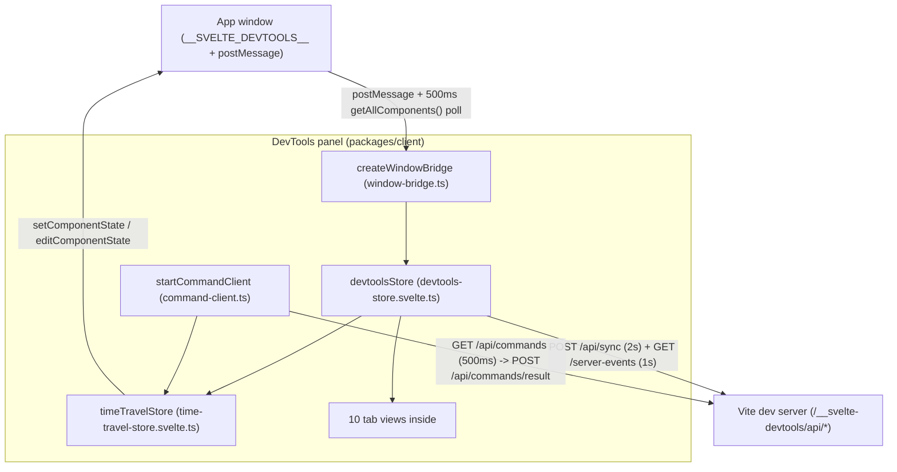

# Client UI

The client package (`packages/client`) is the Svelte DevTools panel UI. It is a Svelte 5 runes application built with Vite and served statically from `packages/client/dist/` at `/__svelte-devtools/`.

> **Pre-built artifact warning**: The Vite plugin serves the panel from **`packages/client/dist/`** (`resolvePackageAssets` in `packages/vite-plugin/src/package-assets.ts`). It does **not** compile `packages/client/src/` on demand. Whenever you modify `packages/client/src/`, run `npm run build:client` (or `npm run build` from the repository root) and restart the application dev server.

## Dock rendering and entry point

The Vite plugin registers the panel dock entry with `type: 'iframe'` and `url: '/__svelte-devtools/'` (`DOCK_CONFIG` in `packages/types/src/constants.ts`). The `@vitejs/devtools` 0.4.8 host renders that entry as a `DocumentPictureInPicture` popup window in supported desktop Chromium browsers, or as an embedded iframe in headless Chromium. Unlocking the dock in the browser uses the six-digit `devframe auth code` from the dev-server terminal.

When the Vite plugin serves `/__svelte-devtools/index.html`, it injects `<script>window.__SVELTE_DEVTOOLS_TOKEN__="...";</script>` into `<head>`. The client helper `apiFetch` (`packages/client/src/lib/api.ts`) reads `window.__SVELTE_DEVTOOLS_TOKEN__` and attaches `Authorization: Bearer <token>` to every HTTP API request.

`packages/client/src/main.ts` applies stored appearance preferences before mounting `App.svelte` so the theme, interface scale, and reduced-motion rules take effect without a visual flash:

```typescript
// Source: packages/client/src/main.ts
import './theme.css';
import { mount } from 'svelte';
import App from './App.svelte';
import { applyPreferences, readPreferences } from './lib/preferences';
import { devtoolsStore } from './lib/stores/devtools-store.svelte';

function init() {
  applyPreferences(readPreferences());
  const target = document.getElementById('app');
  if (!target) return;
  devtoolsStore.init();
  mount(App, { target });
}
```

## Architecture and communication flow



## Shell, error boundary, and tabs

`App.svelte` (`packages/client/src/App.svelte`) renders the top status bar, the 64px vertical `Sidebar.svelte`, and the active tab content area:

- **Status bar**: Contains the Svelte DevTools brand header, the **Inspect components** toggle button (`devtoolsStore.toggleInspector()`, which calls `enableInspector()`/`disableInspector()` on `window.parent.__SVELTE_DEVTOOLS__`), and the `Connected`/`Disconnected` status pill. When the user clicks a highlighted element in the application page, the `inspect:select` bridge callback switches `activeTab` to `'components'` and selects that component ID.
- **View error boundary (`<svelte:boundary>`)**: `App.svelte` wraps the active tab view in Svelte 5's `<svelte:boundary>` with a `{#snippet failed(error, reset)}` fallback. If any tab throws a rendering error, the boundary catches it inside the content pane and displays an alert card (`"This panel hit an error"`), the error message, an expandable `<details>` stack trace, and a **Try again** button wired to `reset`—keeping the status bar and sidebar functional so you can switch tabs or recover without reloading the panel.

`Sidebar.svelte` (`packages/client/src/components/Sidebar.svelte`) defines **10 tabs**:

| Sidebar label | `activeTab` ID | Component (`packages/client/src/components/`) | Purpose |
|---|---|---|---|
| **Info** | `'info'` | `Dashboard.svelte` | Workspace overview, connection and MCP sync status, and metric cards that navigate to tabs |
| **Components** | `'components'` | `ComponentTree.svelte` + `ComponentDetail.svelte` | Virtualized, searchable component tree and per-instance Props, State, DOM, and Source inspector inside a `SplitPane` |
| **Events** | `'timeline'` | `Timeline.svelte` | Filtered chronological stream of component, state, effect, server, and client request events with a `SplitPane` JSON detail view |
| **Time Travel** | `'timetravel'` | `TimeTravelConsole.svelte` | Snapshot recording toggle (`Paused`/`Recording`), undo/redo/play/clear toolbar, snapshot list, and state-diff detail pane |
| **Graph** | `'graph'` | `ComponentGraph.svelte` | `vis-network` force-directed component hierarchy graph with double-click navigation to **Components** |
| **Network** | `'network'` | `NetworkDesk.svelte` | Unified SSR, server fetch, SQLite (`server:sql`), and browser `fetch` inspector plus the browser `fetch` Mock Rules editor |
| **Router** | `'router'` | `RouterHub.svelte` | SvelteKit route inventory from `GET /__svelte-devtools/api/routes` with file badges and click-to-navigate |
| **Assets** | `'assets'` | `Assets.svelte` | Inspected app resource list (`PerformanceResourceTiming` + `PerformanceObserver`) with list/grid views and image previews |
| **Migrate** | `'migration'` | `MigrationScore.svelte` | Per-file Svelte 4 -> Svelte 5 migration percentage bars from `GET /__svelte-devtools/migration-score` |
| **Settings** | `'settings'` | `Settings.svelte` | Theme (`system`/`light`/`dark`), interface scale (`0.8x`–`1.3x`), reduce motion toggle, data actions, and defaults reset |

> **Note**: Unused legacy client files (`src/panel.ts` and `src/components/ServerView.svelte`) have been removed. See [ADR-0011](adr/ADR-0011-remove-dead-code-plugins-bridge.md).

## Shared resizable inspection layouts (`SplitPane.svelte`)

Five inspection views use `SplitPane.svelte` (`packages/client/src/components/SplitPane.svelte`, see [ADR-0015](adr/ADR-0015-shared-resizable-inspection-layouts.md)):
- **Components** (`App.svelte`, `initial={36}`)
- **Events** (`Timeline.svelte`, `secondVisible={!!selectedEntry}`)
- **Time Travel** (`TimeTravelConsole.svelte`, `secondVisible={!!selectedSnapshot}`)
- **Network** (`NetworkDesk.svelte`, Requests view)
- **Assets** (`Assets.svelte`, `secondVisible={!!selectedAsset}`)

`SplitPane.svelte` implements an accessible ARIA window splitter (`role="separator"`, `tabindex="0"`):
- **Clamp and responsive stacking**: The split percentage is clamped between `20%` and `80%` (default `initial = 55`). When the container width is below `600px` (`width > 0 && width < 600`), the layout switches from side-by-side columns to top-and-bottom stacked rows (`aria-orientation="horizontal"`).
- **Pointer and keyboard control**: Drag the separator with the primary pointer button, double-click the separator to reset to `initial`, or focus the separator and use `ArrowLeft`/`ArrowRight` (`ArrowUp`/`ArrowDown` when stacked) to move by `2%` (`10%` with `Shift`), `Home` for `20%`, `End` for `80%`, and `Enter` to reset to `initial`.

## Window bridge (`window-bridge.ts`)

`createWindowBridge()` (`packages/client/src/lib/bridge/window-bridge.ts`) connects the panel iframe to the application window (`window.parent`):

1. **Origin and source validation**: `isValidBridgeMessage` accepts a `MessageEvent` only if `event.source === targetWindow` (`window.parent`), `event.origin` uses `http:` or `https:` on `localhost`, `127.0.0.1`, `::1`, or `[::1]`, and `event.data?.source === 'svelte-devtools'`.
2. **Type and payload mapping**: Incoming runtime event types are mapped through `mapRuntimeEventTypeToBridge` (`packages/types/src/constants.ts`) and `mapPostMessagePayload`:
   - `state`, `derived`, `inspect` -> `state:change` (`{ componentId, key, value, prevValue, type: inspectType }`)
   - `effect`, `effect.pre` -> `effect:run` (`{ componentId, effectName, dependencies, duration }`)
   - `props`, `bindable`, `component-register` -> `component:mount` (`{ id, name, filename, parentId }`)
   - `component:unmount` -> `component:unmount` (`{ id, name }`)
   - `trace:trigger` -> `trace:trigger`
   - `client:request`, `inspect:toggle`, `inspect:select` -> passed through unchanged
3. **500ms reconciliation poll**: During startup, the bridge polls for `window.parent.__SVELTE_DEVTOOLS__` every `100ms` (up to `5000ms`), and then runs `syncComponents()` every `500ms`. `syncComponents()` calls `parentApi.getAllComponents()`, serializes `props` and `state` through `toDisplayValue`, and synthesizes a `component:mount` callback for any mounted instance ID not yet in `mountedComponents`. When a `component:unmount` message arrives, the ID is removed from `mountedComponents`.

## Runes stores

### 1. `devtoolsStore` (`devtools-store.svelte.ts`)

`devtoolsStore` (`packages/client/src/lib/stores/devtools-store.svelte.ts`) is the primary Svelte 5 runes singleton managing panel state:

- **Session identity (`panelSessionId`)**: Generates a `crypto.randomUUID()` session ID when the panel loads.
- **Debounced state-change batching**: When `state:change` events arrive from the bridge, `handleStateChange` pushes them into `pendingStateChanges` and schedules a `setTimeout(..., 0)` flush (`flushStateChanges`). The flush collapses rapid updates to the latest value per `(componentId, key)`, updates `components` in one immutable pass, and appends all new `state:change` entries to `timeline` in a single array copy (capped at `1000` entries). See [ADR-0002](adr/ADR-0002-debounced-state-change-batching.md).
- **Motion gate (`SETTLE_TOLERANCE = 0.0015`)**: State values containing numeric `current` and `target` properties (emitted by the `$effect` watcher on `Spring` and `Tween` instances) are checked before batching. While `Math.abs(cur - tgt) >= 0.0015`, the key is added to `activeMotions` and the mid-animation frame is dropped. Once `Math.abs(cur - tgt) < 0.0015`, the key is removed from `activeMotions` and one settled value is recorded (skipping duplicates within `0.0015` of `_lastCur`). When a component unmounts, `handleComponentUnmount` purges its keys from `activeMotions`, `_lastCur`, and `pendingStateChanges` so an unmounted animation never blocks snapshot capture.
- **Periodic server sync (`2000ms`)**: `syncStateToServer()` sends an authenticated `POST /__svelte-devtools/api/sync` every `2s` with `{ sessionId: panelSessionId, components, timeline, snapshots, branches }` (`AbortSignal.timeout(10000)`). A `syncInFlight` boolean ensures at most one sync request is in flight at a time. It uses `apiFetch` rather than `navigator.sendBeacon` so large state snapshots do not hit the browser's 64 KB beacon quota.
- **Server events poll (`1000ms`)**: `fetchServerEvents()` polls `/__svelte-devtools/server-events?last=50` initially and `?sinceId=<lastEventId>` every `1s`, appending new server events to `serverEvents` and `timeline` (each capped at `1000` entries).
- **Remote command polling (`500ms`)**: `startCommandClient` (`packages/client/src/lib/command-client.ts`) polls `GET /__svelte-devtools/api/commands?sessionId=<panelSessionId>&url=<appUrl>` every `500ms`. When an agent submits a state edit via `POST /__svelte-devtools/api/set-state` (or MCP `svelte_set_state`), the command client enables recording (`isRecording = true`), calls `timeTravel.setStateEdit(componentId, key, value)`, awaits `tick()`, reads back the live value from `__SVELTE_DEVTOOLS__.getComponentById(componentId)?.state.get(key)`, and acknowledges the result via `POST /__svelte-devtools/api/commands/result`. Failed mutations are never automatically retried.

### 2. `timeTravelStore` (`time-travel-store.svelte.ts`)

`createTimeTravelStore` (`packages/client/src/lib/stores/time-travel-store.svelte.ts`) manages state snapshots (`snapshots`, `currentIndex`, `isTimeTravelMode`, capped at `LIMITS.MAX_STATE_SNAPSHOTS = 50`):

- **Opt-in recording**: The panel starts with `isRecording = false` (`Paused`). Snapshots are captured only after the user clicks the **Record** button (`.record-btn`) in the Time Travel tab or saves a live state edit.
- **Snapshot capture and deduplication (`doCapture`)**: Deep-clones `components`, `timeline`, and `kitState` (the parent window's URL). To prevent phantom snapshots after undo/redo, `doCapture` skips capture if `JSON.stringify(comps)` matches `lastRestoredSnapshotJSON` or if neither `components` nor `timeline.length` changed since `lastCapturedState`. If `currentIndex < snapshots.length - 1` (viewing a historical snapshot) and the user makes a new state change, future snapshots after `currentIndex` are truncated.
- **Instance resolution (`resolveSnapshotInstances`)**: Before applying a snapshot, `resolveSnapshotInstances` (`packages/client/src/lib/stores/snapshot-identity.ts`) matches each snapshot component to a live mounted component:
  1. If a live component has the exact same per-instance `id` (`svt-<hash>:<uid>`), it maps directly.
  2. After a cross-route navigation (where components remount with new `$props.id()` suffixes), it falls back to matching by `filename`—but only if both the snapshot and the live page have **exactly one** instance of that `filename`. If multiple instances share the file and the original ID is gone, it throws an explicit error (`"Cannot restore <Name>: the original instance is no longer mounted and its source does not identify one unique instance."`), which `TimeTravelConsole.svelte` displays in an alert banner. See [ADR-0017](adr/ADR-0017-instance-safe-state-mutation.md).
- **Same-route and cross-route restore (`restore` and `doRestore`)**:
  1. If the snapshot's `kitState.url` differs from the parent window's current path, `restore` navigates first using `window.parent.__SVELTE_DEVTOOLS_REAL_GOTO__(targetPath, { replaceState: true, keepFocus: true, noScroll: true })` (from the virtual navigation bridge, see [ADR-0012](adr/ADR-0012-stop-stubbing-app-navigation.md)) or a synthetic `<a>` click fallback, then polls `parentApi.getAllComponents()` every `50ms` (up to `2000ms`) until all snapshot component files are mounted.
  2. `doRestore` sets `isTimeTravelMode = true`, stores `lastRestoredSnapshotJSON`, updates the store's `components` and `timeline`, and calls `pushStateToApp(snapshot.components)`.
  3. `pushStateToApp` wraps per-key `parentApi.setComponentState(comp.id, key, value)` calls in `startInspectBatch()` / `endInspectBatch()` / `flushAllEffects()`, skipping live `Map` and `Set` values.
  4. `isTimeTravelMode` stays `true` until the next `stateFlushTimer` macrotask in `devtoolsStore` drains the resulting `$inspect` echoes and calls `timeTravel.clearTimeTravelMode()`.
- **Live state editing (`setStateEdit`)**: Verifies that `parentApi.editComponentState` exists and `parentApi.getWritableStateKeys(componentId)` includes `key`, captures a baseline `'Before state edit'` snapshot for undo, and calls `parentApi.editComponentState(componentId, key, value)`.

## Tab details and key workflows

### Info (`Dashboard.svelte`)

Polls `GET /__svelte-devtools/api/` and `GET /__svelte-devtools/api/routes` on mount and every `3000ms`. It displays four metric buttons (**Components**, **State variables**, **Server requests**, **Routes**) that navigate directly to their tabs, quick-start tool cards, and an **MCP** status card indicating whether the first panel sync has completed (`status.capabilities.runtimeData.hasSynced`).

### Components (`ComponentTree.svelte` and `ComponentDetail.svelte`)

- **Virtualized tree (`ComponentTree.svelte`)**: Indexes parent-child relationships once per update via `indexComponentTree` and flattens expanded nodes via `flattenComponentTree` (`packages/client/src/lib/component-tree.ts`). Rows are virtualized at `32px` height (`updateVisibleRange`). Each row displays the expand/collapse toggle, component name, optional render duration badge (highlighted when `> 16ms`), and a clickable source badge (`formatSourceLocation`).
- **Component search (`component-search.ts`)**: Typing in the search input (`Search components...`) filters `flatList` via `filterEntriesByQuery` and `matchesComponentQuery` (`packages/client/src/lib/component-search.ts`) and displays a live `<N> match(es)` pill:
  - Matches case-insensitively against the component's `name`, `filename`, any `state` key name, or any primitive `state` value (`string`, `number`, `boolean`) up to **two container levels deep** (`MAX_VALUE_DEPTH = 2`, where a top-level state property is level 1 and elements inside an array or plain object are level 2).
  - Because `toDisplayValue` serializes plain objects with a `null` prototype (`Object.create(null)`), `valueMatches` traverses objects via `Object.values(...)` and only calls `String(...)` on `number` and `boolean` primitives—never calling `String(obj)` on a null-prototype object, which would throw a `TypeError` and crash the panel.
  - Pressing `Escape` while the search input is focused clears `searchTerm` when non-empty. When no components match, an empty-state message (`No components match "<searchTerm>"`) is shown.
- **Component detail (`ComponentDetail.svelte`)**: Provides four sub-tabs for the selected component instance:
  - **Props**: Displays each destructured `$props()` key and value (using `JsonTree.svelte` for expandable objects and arrays).
  - **State**: Lists all tracked rune values. Keys returned by `window.parent.__SVELTE_DEVTOOLS__.getWritableStateKeys(component.id)` show an **Edit** button; `$derived` values, functions, collections (`Map`/`Set`), and class instances show a **Read-only** badge. Clicking **Edit** opens a JSON `<textarea>` prefilled from the live component state map (`getComponentById(componentId)?.state.get(key)`). Clicking **Save & record** parses the JSON, sets `devtoolsStore.isRecording = true`, and calls `devtoolsStore.timeTravel.setStateEdit(id, key, value)`. See [ADR-0017](adr/ADR-0017-instance-safe-state-mutation.md) and [ADR-0020](adr/ADR-0020-bounded-observation-and-live-value-separation.md).
  - **DOM (`DomInfo.svelte`)**: Queries `window.parent.document.querySelector('[data-svelte-devtools-id="' + componentId + '"]')` and displays the element's tag name, `id`, `className`, child element count, bounding client rectangle (`width×height @ (x, y)`), and `data-*` attributes.
  - **Source**: Shows the component's `filename` and an **Open `<file>` in editor** button wired to `openInEditor` (`packages/client/src/lib/open-in-editor.ts`). If `POST /__svelte-devtools/open-in-editor` fails, an inline `role="alert"` message displays the error.

### Graph (`ComponentGraph.svelte`)

Renders a force-directed component hierarchy graph using `vis-network` (`forceAtlas2Based` solver, stabilized after 100 iterations). Nodes are sized by their state variable count (`20 + Math.min(stateCount, 10) * 2`). The graph rebuilds only when the topology key (`components.map(c => c.id + ':' + c.parentId).join('|')`) changes, and destroys the `vis-network` instance on tab exit.

**Double-click to inspect**: Double-clicking any node in the graph invokes `openInComponentPanel(nodeId)`:
1. It calls `onSelect(nodeId)`, which switches `App.svelte` to the **Components** tab (`activeTab = 'components'`) and selects that component instance in `ComponentDetail.svelte`.
2. It queries `window.top.document` (or `window.parent.document`) for `[data-svelte-devtools-id="<nodeId>"]`, scrolls the element smoothly into the center of the viewport (`scrollIntoView({ behavior: 'smooth', block: 'center' })`), and highlights it with a `2px solid #FF3E00` outline for `1500ms`.

### Network and Mock Rules (`NetworkDesk.svelte`)

`NetworkDesk.svelte` (`packages/client/src/components/NetworkDesk.svelte`) combines server traces and browser `fetch` requests into a single bounded history (`NetworkHistory` in `packages/client/src/lib/network-history.ts`, retaining up to `500` visible rows from `1000`-entry producer buffers):

- **Requests view**:
  - Polls `GET /__svelte-devtools/api/server-events` every `1000ms` via `startServerTracePoll` (`packages/client/src/lib/server-traces.ts`), with an `AbortController` guard so polls never overlap.
  - Ingests browser `client:request` events from `devtoolsStore.timeline`.
  - Filter buttons filter by **All**, **SSR** (`server:ssr` and `server:request`), **SQL** (`server:sql`), **Errors** (`server:error`, `status === 'error'`, or HTTP status `>= 400` / `0`), **Client** (`client:request`), and **Mocked** (`mockResponse === true`). The text input filters across `url`, `method`, `routeId`, SQL `statement`, and `traceId`.
  - Clicking **Clear** (`history.clear()`) dismisses all currently retained IDs so cleared rows are not replayed on the next poll.
  - Selecting a server entry renders `ServerTraceDetail.svelte` (`packages/client/src/components/ServerTraceDetail.svelte`), which displays SQLite metadata (`database`, `operation`, `rowCount`, opt-in SQL `statement` with a **Copy SQL** button, or a note explaining how to enable `captureStatement`), trace/span/parent IDs, and an interactive **Trace waterfall** of all spans sharing the same `traceId` ordered by timestamp and span ancestry depth (`traceRows` in `packages/client/src/lib/server-traces.ts`).
- **Mock Rules editor flow**:
  - You can create a rule either by switching to the **Mock Rules** sub-tab or by selecting any `client:request` row in the **Requests** detail pane and clicking **Mock this request** (`mockRequest(selectedEntry)`).
  - Clicking **Mock this request** switches to the **Mock Rules** editor and prefills the form:
    - **URL pattern**: Escapes all regular expression metacharacters in `entry.url` and wraps it in `^...$` for an exact match.
    - **Method**, **Status** (defaults to `200` if `< 200`), **Content type** (from `responseHeaders['content-type']` or `'application/json'`), and **Response body** (from `entry.responseBody`).
    - If `entry.responseBodyTruncated` is `true` (browser `fetch` previews are capped at `500` bytes), a warning banner appears: `"This response preview is incomplete. Replace it with a complete response body before saving."`
  - When you click **Enable mock rule** (or **Save changes** when editing an existing rule), `addRule()` validates that:
    1. `newPattern` is non-empty and compiles with `new RegExp(newPattern)`.
    2. `newStatusCode` is an integer from `200` to `599`.
    3. Status codes `204`, `205`, and `304` have an empty response body.
    4. If `newBody` is non-empty and `newContentType` matches `application/json` or `+json`, `JSON.parse(newBody)` succeeds.
  - Saved, toggled, or deleted rules are synced to the runtime in the parent window via `window.parent.postMessage({ type: 'svelte-devtools-set-mock-rules', rules: $state.snapshot(mockRules) }, window.location.origin)`. When the Network tab mounts, it also sends `{ type: 'svelte-devtools-get-mock-rules' }` to restore any rules already active in the current page session.
  - **Scope limit**: Mock rules intercept browser `window.fetch` calls only. Native `XMLHttpRequest`, server-side SSR `fetch` calls, and `/__svelte-devtools/*` or `/.devtools/*` requests are not mocked. Active mock rules live in the runtime's memory and reset when the application page reloads.

### Router (`RouterHub.svelte`)

Fetches `GET /__svelte-devtools/api/routes` on mount (and via the **Refresh** button), tracks the parent window's `location.pathname` every `500ms`, and lists all scanned SvelteKit routes with badges for `page`, `layout`, `api` (`+server`), `error`, `load`, `server load`, route groups, and active URL status. Routes with a `+page` file and no dynamic bracket parameters (`route.navigable === true`) have an enabled visit button that calls `target.location.assign(basePath + route.cleanedUrl)` on the application window (`window.parent` or `window.opener`).

### Settings and preferences persistence (`Settings.svelte` and `preferences.ts`)

`Settings.svelte` (`packages/client/src/components/Settings.svelte`) and `packages/client/src/lib/preferences.ts` manage three appearance settings and two data actions:

- **Theme**: `'system'` (default, follows `@media (prefers-color-scheme: dark)` in `theme.css`), `'light'`, or `'dark'`. Applied by setting or deleting `document.documentElement.dataset.theme` and setting `document.documentElement.style.colorScheme`. Stored in `localStorage` under `'svelte-devtools-theme'`.
- **Interface Scale**: `0.8` (`Tiny`), `0.9` (`Small`), `1` (`Normal`, default), `1.15` (`Large`), or `1.3` (`Huge`). Applied by setting `zoom` and `--devtools-ui-scale` on `document.documentElement` (and compensating `height: calc(100vh / var(--devtools-ui-scale, 1))` on `.panel` in `App.svelte`) so text and controls scale together without clipping. Stored under `'svelte-devtools-scale'`.
- **Reduce Motion**: Boolean toggle (`false` default). Sets `document.documentElement.dataset.reduceMotion = "true"`, which disables all CSS animations, transitions, and smooth scrolling in `theme.css`. Stored under `'svelte-devtools-reduce-motion'`.
- **Storage fallback**: `savePreferences` and `resetPreferences` always apply changes to `document.documentElement` immediately and wrap `localStorage` access in `try / catch`. If browser storage is blocked, `Settings.svelte` informs the user (`"Settings applied. Browser storage is unavailable; changes will not persist after reload."`).
- **Data actions**: Provides buttons to clear all recorded timeline events (`devtoolsStore.clearTimeline()`) and force a component tree refresh (`devtoolsStore.refresh()`).

## Styling (`theme.css`)

`packages/client/src/theme.css` defines a light-default, dark-adaptive design system using CSS custom properties (`--bg-base`, `--bg-surface`, `--bg-elevated`, `--bg-inset`, `--bg-sidebar`, `--text-primary`, `--text-secondary`, `--text-muted`, `--svelte-brand: #FF3E00`, `--accent-primary`, `--border-default`, `--font-ui`, `--font-mono`). In `system` mode, `@media (prefers-color-scheme: dark)` switches `:root:not([data-theme="light"])` to the dark palette; `[data-theme="dark"]` and `[data-theme="light"]` enforce manual overrides.

## Communication summary

| Direction | Mechanism | Purpose |
|---|---|---|
| Runtime -> Panel | `window.postMessage` (`{ source: 'svelte-devtools', type, payload }`) | Push component mounts/unmounts, `$inspect` state changes, `$effect` runs, `client:request` traces, and inspector events |
| Panel -> Runtime | Direct calls on `window.parent.__SVELTE_DEVTOOLS__` | `getAllComponents()` 500ms poll, `setComponentState()`, `editComponentState()`, `getWritableStateKeys()`, batch markers, and `enableInspector()` / `disableInspector()` |
| Panel <-> Runtime | `window.postMessage` (`svelte-devtools-get-mock-rules`, `svelte-devtools-set-mock-rules`, `svelte-devtools-mock-rules`) | Synchronize browser `fetch` mock rules within the same origin |
| Panel -> App window | `target.location.assign(...)` / `window.parent.__SVELTE_DEVTOOLS_REAL_GOTO__` | Navigate to routes from **Router** or cross-route **Time Travel** restore |
| Panel -> Vite server | `apiFetch` (`Authorization: Bearer <window.__SVELTE_DEVTOOLS_TOKEN__>`) | `POST /api/sync` (2s), `GET /server-events` (1s), `GET /api/server-events` (1s in Network tab), `GET /api/commands` (500ms), `POST /api/commands/result`, `GET /api/routes`, `GET /migration-score`, `POST /open-in-editor` |
